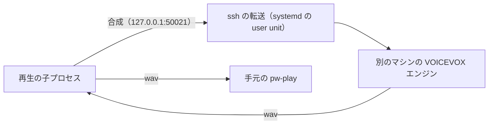

# 環境ごとの設定

ccspk のコードと設定は変えずに、マシンの側で整える設定をまとめる。

## 1. 別のマシンの VOICEVOX で合成し、手元で鳴らす

CPU の遅いマシンでは、VOICEVOX の合成に 1 文で数十秒かかり、フックの合成と重なると時間切れで落ちる。
そのときは、合成だけを別のマシンのエンジンで行い、音は手元の `pw-play` で鳴らす。
ssh でエンジンのポート（50021 番）を手元へ転送するだけで、`ccspk` には何も設定しない。

[`ccspk remote`](UsersGuide.md#111-ssh-先の-voicevox-で鳴らす) との違いは、鳴らす場所。`ccspk remote` は ssh 先の `pw-play` で鳴らすので、
音は ssh 先のスピーカーから出る。ここでの設定では手元のスピーカーから出る。



1. 別のマシンに、[1.1](UsersGuide.md#11-voicevox-エンジン) のとおりエンジンを入れて起動しておく。手元からは鍵で、パスワードを聞かれずに
   ssh でつながるようにしておく
2. 手元のエンジンを止める。50021 番を転送に使うため。unit ファイルは消さなくてよい

   ```sh
   systemctl --user disable --now voicevox-engine.service
   ```

3. 転送の unit を `~/.config/systemd/user/voicevox-forward.service` に置く。`192.168.0.10` は別のマシンに置き換える

   ```ini
   [Unit]
   Description=192.168.0.10 の VOICEVOX エンジンを 127.0.0.1:50021 へ転送する
   After=network-online.target

   [Service]
   ExecStart=/usr/bin/ssh -x -N -o BatchMode=yes -o ExitOnForwardFailure=yes -o ServerAliveInterval=30 -o ServerAliveCountMax=3 -L 127.0.0.1:50021:127.0.0.1:50021 192.168.0.10
   Restart=always
   RestartSec=10

   [Install]
   WantedBy=default.target
   ```

   - `BatchMode=yes`: パスワードを聞かずに失敗させる（unit からは答えられない）
   - `ExitOnForwardFailure=yes`: 50021 番を使えないときは ssh を終わらせ、`Restart=always` で張り直させる
   - `ServerAliveInterval`・`ServerAliveCountMax`: 相手が落ちたのを 90 秒ほどで見つけて張り直す

4. 起動して、エンジンにつながるか確かめる

   ```sh
   systemctl --user daemon-reload
   systemctl --user enable --now voicevox-forward.service
   curl -s http://127.0.0.1:50021/version   # 別のマシンのエンジンの版が返る
   ccspk say 'テスト'
   ```

転送が切れているあいだに返答が来ると、鳴らせないと記録されて読み上げが止まったままになることがある。
つながり直したら `ccspk status --clear` で消す（[1.5](UsersGuide.md#15-読み上げが止まったままのとき)）。

辞書は別のマシンのエンジンに登録され、書き出すのは手元の `~/.config/ccspk/user_dict.json`。
別のマシンのエンジンは起動のたびに自分のマシンの辞書のファイルを読むので、再起動しても辞書を戻したいときは、
手元のファイルを別のマシンへ写しておく（[2.1](UsersGuide.md#21-辞書のファイル)）。

## 2. HDMI がつながっているときは HDMI から鳴らす

アナログと HDMI の出力が 1 枚のカードのプロファイルの切り替えになっていると、HDMI をつないでもアナログのプロファイルのままになることがある
（プロファイルの優先度はアナログのほうが高い）。WirePlumber 0.5 の `device.profile.priority.rules` で、HDMI のプロファイルを先にする。

1. `~/.config/wireplumber/wireplumber.conf.d/51-hdmi-first.conf` を置く

   ```
   # HDMI がつながっているときは HDMI から鳴らす。抜くと HDMI のプロファイルが使えなくなり、アナログに戻る
   device.profile.priority.rules = [
     {
       matches = [
         { device.name = "~alsa_card.*" }
       ]
       actions = {
         update-props = {
           priorities = [
             "output:hdmi-stereo+input:analog-stereo"
             "output:hdmi-stereo"
             "output:analog-stereo+input:analog-stereo"
             "output:analog-stereo"
           ]
         }
       }
     }
   ]
   ```

   プロファイルの名前はカードで違う。`pactl list cards` の `Profiles:` に名前と優先度（`priority`）が出るので、それに合わせる

2. WirePlumber を再起動する

   ```sh
   systemctl --user restart wireplumber
   ```

HDMI をつないだまま `ccspk say` で HDMI から聞こえることは確かめてある。HDMI を抜いたときにアナログへ戻るかは、まだ確かめていない。
